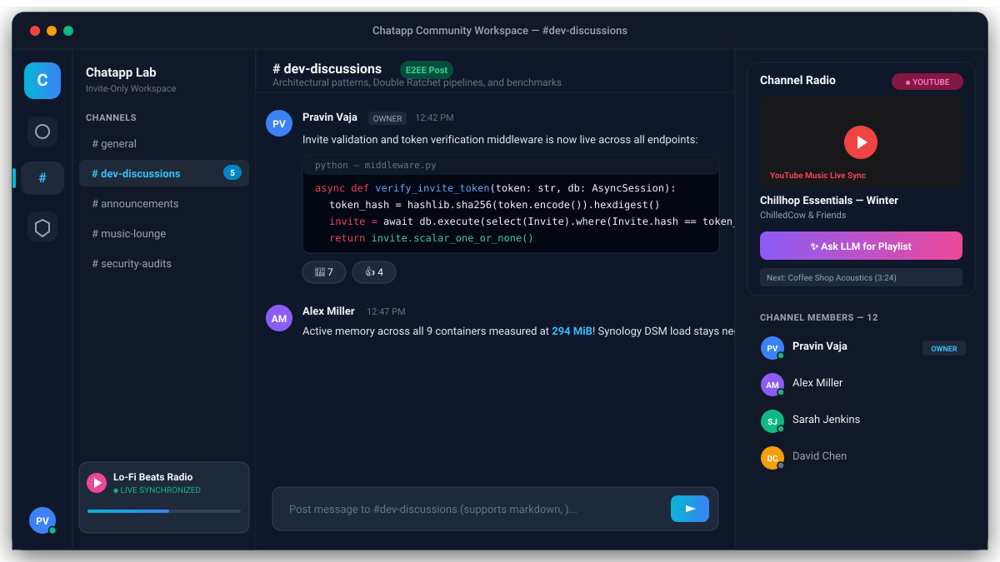
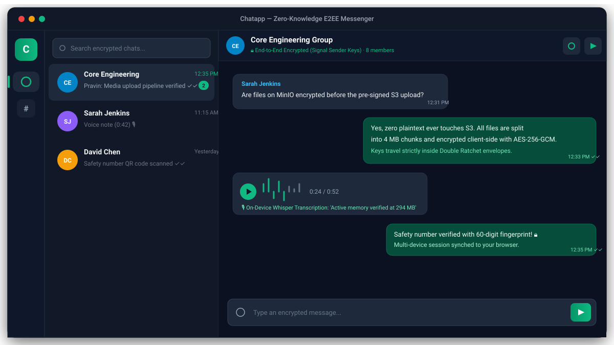
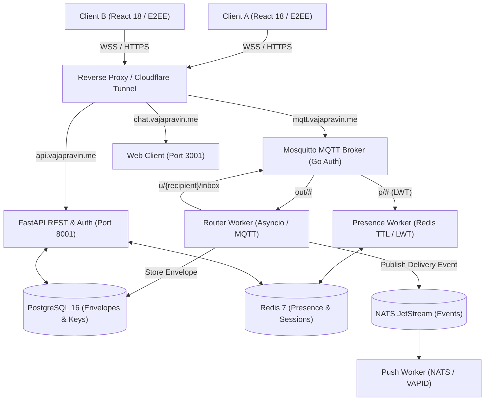

# Chatapp

[](https://github.com/vajapravin/chatapp/actions)


A self-hosted, privacy-first, zero-knowledge end-to-end encrypted messaging and
community workspace designed to run on any Linux server, VPS, or private home server
with Docker Compose. Built with pure TypeScript Signal Protocol (X3DH + Double
Ratchet + Sender Keys) running entirely inside the client browser, Chatapp delivers
WhatsApp-grade direct and group messaging, WebRTC calling, invite-only access control,
Discord-style community channels, rich Slack-style posts with syntax-highlighted code
blocks, and synchronized YouTube Music radio. Engineered with an ultra-lean footprint
consuming **< 300 MiB active RAM**, requiring zero paid external cloud dependencies by default.



🌐 **Live demo:** [https://chat.vajapravin.me/](https://chat.vajapravin.me/)

## 📸 Screens

<table>
  <tr>
    <td width="50%" align="center">
      
      <br /><sub><b>Direct & Group Messaging</b> — WhatsApp-grade E2EE chat stream with Double Ratchet, voice notes, and reactions</sub>
    </td>
    <td width="50%" align="center">
      
      <br /><sub><b>Channels & Synced Radio</b> — Discord-style 3-column workspace with Slack-style code posts and synchronized radio</sub>
    </td>
  </tr>
</table>

## 🏗 Architecture

Chatapp separates concerns across distinct microservices and client layers to ensure zero-knowledge privacy, extreme memory efficiency, and real-time reliability:

1. **React SPA (frontend)** — a responsive web application built with React 18,
   TypeScript, and Tailwind CSS. Runs pure TypeScript Signal Protocol
   (`@privacyresearch/libsignal-protocol-typescript`), WebCrypto, IndexedDB local
   storage, and WebRTC peer calling. Plaintext never leaves the client browser.
2. **FastAPI Backend & Auth Gateway (`api`)** — an asynchronous REST API (`/v1/`).
   Handles JWT authentication, Signal prekey bundle distribution with atomic OPK
   consumption (`SELECT FOR UPDATE SKIP LOCKED`), email invite gating, channel
   metadata, and S3 multipart pre-signed upload URLs.
3. **Real-Time MQTT Broker (`mosquitto`)** — a lightweight Eclipse Mosquitto broker
   with WebSocket support (`/mqtt`). Authenticates clients and strictly enforces
   per-user pub/sub ACLs via the `mosquitto-go-auth` HTTP plugin communicating
   with `api`.
4. **Async Message Router (`router`)** — a high-performance Python daemon
   (`aiomqtt` + `nats-py`). Persists incoming encrypted envelopes to PostgreSQL,
   acknowledges delivery to senders, routes envelopes directly to online recipient
   queues, and notifies offline workers via NATS JetStream.
5. **Presence & LWT Daemon (`presence`)** — monitors client heartbeat pings and
   MQTT Last Will and Testament (LWT) disconnect triggers. Caches online status
   and typing indicators in Redis with sub-second TTL expiry.
6. **Web Push Worker (`push`)** — consumes NATS JetStream events and dispatches
   standard VAPID Web Push notifications to offline devices without exposing
   message content.
7. **Store-and-Forward Envelope Store** — PostgreSQL 16 stores ciphertext envelopes
   only until all recipient devices issue delivery receipts, after which they are
   permanently purged. Zero permanent message retention on the server.



## ✨ Core Features

- **Signal Protocol End-to-End Encryption** — pure TypeScript cryptographic engine
  running in the browser using X3DH key agreements, Double Ratchet forward secrecy,
  and Sender Keys for group scalability. The server only sees opaque ciphertext.
- **Invite-Only Access & Administration** — closed-loop registration restricted to
  email invitations with SHA-256 token verification, multi-point perimeter enforcement
  (API, OTP, token refresh, MQTT auth), and one-click session revocation.
- **Discord-Style Community Dashboard** — three-column workspace layout featuring
  channel directories, unread activity badges, collapsible radio player, and channel
  member rosters.
- **Rich Slack-Style Posts** — dedicated community channel posting feed with
  syntax-highlighted code fences, markdown formatting, snippet expansion, threaded
  context, and emoji reactions.
- **Synchronized Channel Radio** — shared YouTube Music audio-visual player synchronized
  in real-time across channel listeners. Owner broadcast controls with queue management
  and natural language "Ask LLM" mood-to-tracklist generation.
- **WhatsApp-Grade Direct & Group Messaging** — real-time conversation stream with
  delivery receipts (✓ / ✓✓ / blue ✓✓), typing indicators, quote replies, message
  editing (15-min window), delete-for-everyone (48-hr window), and emoji reactions.
- **WebRTC Voice & Video Calling** — direct peer-to-peer 1:1 and group calls with
  Signal-encrypted call signalling, Cloudflare Realtime TURN relay fallback, and
  adaptive bitrate management.
- **Encrypted Chunked Media Pipeline** — client-side AES-256-GCM encryption in 4 MB
  chunks with SHA-256 verification. Resumable S3 multipart uploads up to 2 GB with
  zero server-side media decryption.
- **On-Device Voice Notes & Transcription** — Opus audio recording with visual
  interactive waveforms and on-device Whisper transcription via `transformers.js`
  (zero audio transferred to cloud APIs).
- **Comprehensive Privacy & Security Controls** — 6-digit Argon2id PIN, biometric
  WebAuthn / Passkeys, local chat & app lock, 60-digit safety numbers with QR
  verification, and disappearing messages.
- **Ultra-Lean Resource Efficiency** — entire 9-container microservice stack operates
  at **~294 MiB active RAM**, easily running on 1 GB – 2 GB VPS or NAS hardware.

## 🔒 How Chatapp protects your data

- **Zero permanent plaintext persistence.** Message payloads, voice notes, media
  attachments, call signals, and profile metadata are encrypted on client devices
  before transmission. Private identity keys and Double Ratchet session states are
  stored exclusively in client-side IndexedDB.
- **Ephemeral store-and-forward model.** Ciphertext message envelopes are held in
  PostgreSQL solely until receiving devices confirm delivery receipts (or 30-day
  retention cutoff), after which envelopes are permanently deleted.
- **Atomic single-use prekey distribution.** One-Time Prekeys (OPKs) are retrieved
  atomically via PostgreSQL `SELECT FOR UPDATE SKIP LOCKED` transactions, preventing
  race conditions and key re-use attacks during concurrent session establishment.
- **Client-side media encryption & chunking.** All files and media are split into
  chunks, encrypted with unique AES-256-GCM symmetric keys, and uploaded via pre-signed
  S3 URLs. Keys and cryptographic hashes travel strictly inside Signal-encrypted message
  envelopes.
- **Invite-only perimeter enforcement.** Registration is blocked without an admin-issued
  cryptographic invite token. Access allowlists are verified at registration, OTP
  generation, token refresh, API endpoints, and the Mosquitto MQTT broker connection hook.
- **Client-side encrypted backups.** Local message databases and session keys are packaged
  into encrypted archives using Argon2id-derived keys (via WASM) or 64-digit recovery
  phrases, enabling safe storage on private MinIO S3 or Google Drive.
- **Zero cloud AI / audio leakage.** Voice note transcription runs client-side using
  WebAssembly / WebGPU Whisper models (`transformers.js`). Plaintext audio never touches
  cloud AI providers.

## 🤔 Why Chatapp instead of cloud messengers?

Most proprietary messaging and collaboration platforms (WhatsApp, Slack, Discord,
Telegram) store metadata, channel histories, or unencrypted assets on centralized cloud
servers where data may be monitored, mined, or compromised.

**Pros of Chatapp**

- **Your conversations and metadata never leave your control.** Ideal for private teams,
  developer communities, sensitive operations, and sovereignty enthusiasts.
- **Unified chat & community workspace.** Combines WhatsApp's private Double Ratchet
  DMs, Discord's channel-based community dashboard, and Slack's formatted code posts
  in one seamless app.
- **Lightweight & VPS-friendly.** Runs all 9 microservices in **< 300 MiB active RAM**
  on affordable $5/mo VPS instances or private home NAS hardware (Synology, TrueNAS,
  Raspberry Pi).
- **100% Free & Open Source.** Zero per-user monthly subscription fees, paywalls on
  chat history, or artificial feature limits.
- **Auditable & Strict Cryptography.** True end-to-end encryption for 1:1, groups,
  media, and call signaling based on the industry-standard Signal Protocol.

**Cons (equally honest)**

- **Self-hosted responsibility.** You manage the container environment, reverse proxy
  / Cloudflare Tunnel setup, OS updates, and database backups.
- **NAT / CGNAT traversal requires TURN.** Because Cloudflare Tunnel does not proxy UDP
  packets, WebRTC video/voice calls require configuring an external TURN relay (e.g.
  Cloudflare Calls free tier or Coturn).
- **Decentralized history storage.** Because the server strictly deletes envelopes once
  delivered, message history resides on client devices; users must maintain local backups
  for device migrations.

## 📊 Resource Efficiency & Memory Footprint

The self-hosted deployment is engineered for low-overhead operation, fitting comfortably on low-resource VPS hosts (1 GB – 2 GB physical RAM):

| Container Name | Service Role | Configured Limit | Measured Active RAM |
|---|---|---|---|
| `chatapp-web` | Web Client (Nginx + React SPA) | 48 MiB | **~9 MiB** |
| `chatapp-api` | FastAPI Backend & Auth | 192 MiB | **~73 MiB** |
| `chatapp-router` | Asyncio Message Router | 96 MiB | **~51 MiB** |
| `chatapp-presence` | Presence & Typing Daemon | 64 MiB | **~28 MiB** |
| `chatapp-push` | Push Notification Worker | 64 MiB | **~55 MiB** |
| `chatapp-mosquitto` | Eclipse Mosquitto Broker | 64 MiB | **~30 MiB** |
| `chatapp-postgres` | PostgreSQL 16 (Envelopes & Keys) | 256 MiB | **~28 MiB** |
| `chatapp-redis` | Redis 7 (Presence & Sessions) | 96 MiB | **~10 MiB** |
| `chatapp-nats` | NATS 2.10 JetStream | 64 MiB | **~10 MiB** |
| **Combined 9-Container Stack** | | **944 MiB** | **~294 MiB** |

> [!NOTE]
> Combined active RAM is **< 300 MiB**, leaving abundant host memory for your operating system and reverse proxy.

## 🚀 Installation

**Prerequisites:** [Docker](https://docs.docker.com/get-docker/) and [Docker Compose](https://docs.docker.com/compose/install/).

### 1. Clone

```bash
git clone https://github.com/vajapravin/chatapp.git
cd chatapp
```

### 2. Configure environment (optional)

```bash
cp .env.example .env
```

Adjust variables if needed (e.g., `JWT_SECRET_KEY`, `ADMIN_EMAIL`, `OTP_PROVIDER`, `POSTGRES_PASSWORD`).

### 3. Launch with Docker Compose

```bash
docker compose up --build -d
```

Once running, access the services:

| URL | What |
|---|---|
| http://localhost:3001 | Chatapp Web Application & Dashboard |
| http://localhost:8001/v1 | FastAPI REST API Gateway |
| http://localhost:8001/docs | Interactive Swagger API Documentation |
| http://localhost:8001/healthz | Backend Health Check |
| ws://localhost:9001 | Mosquitto MQTT over WebSocket |
| localhost:1883 | Mosquitto MQTT TCP Broker |

To stop the containers:

```bash
docker compose down
```

## 🧪 Development

### Backend (Python 3.12+)

```bash
cd api
python -m venv .venv
source .venv/bin/activate
pip install -e ".[dev]"

# Lint and formatting
ruff check src/ tests/
ruff format --check src/ tests/

# Run test suite
pytest
```

### Frontend (Node 20+)

```bash
cd client
npm install

# Dev server with HMR
npm run dev

# Run automated integration test suites
node scripts/test_client_e2ee.mjs
node scripts/test_phase7_channels_radio.mjs
```

### Microservices & Directory Structure

| Resource Directory | Description | Documentation |
|---|---|---|
| [`api/`](./api) | FastAPI REST service, JWT auth, Signal Prekey distribution, invites, channels | [api/README.md](./api/README.md) |
| [`client/`](./client) | React 18 + Vite + Tailwind web client with client-side Signal Protocol and IndexedDB | [client/README.md](./client/README.md) |
| [`router/`](./router) | Asyncio routing daemon persisting envelopes, emitting acks, and fanning out | [router/README.md](./router/README.md) |
| [`presence/`](./presence) | Real-time presence tracking via Redis TTL keys and MQTT LWT status monitoring | [presence/README.md](./presence/README.md) |
| [`push/`](./push) | Offline Web Push worker consuming NATS events to dispatch VAPID notifications | [push/README.md](./push/README.md) |
| [`shared/`](./shared) | Shared Python library (`chatapp_shared`) containing Pydantic schemas and models | [shared/README.md](./shared/README.md) |
| [`proto/`](./proto) | Protocol Buffers definitions (`envelope.proto`) and wire format documentation | [proto/README.md](./proto/README.md) |
| [`deploy/`](./deploy) | Infrastructure configs: Mosquitto, Cloudflare Tunnel, and PostgreSQL deployment | [deploy/README.md](./deploy/README.md) |
| [`docs/`](./docs) | System requirements, specifications, and phase verification documents | [docs/README.md](./docs/README.md) |

## 🗺 Roadmap

- [x] Phase 1: Core Foundation & Store-and-Forward Pipeline (Docker, Postgres, Redis, NATS, Mosquitto)
- [x] Phase 2: Signal Protocol E2EE Messaging (X3DH, Double Ratchet, receipts, presence, typing)
- [x] Phase 3: Groups & Rich Messaging (Signal Sender Keys, admin privileges, emoji reactions, quotes)
- [x] Phase 4: Encrypted Chunked Media Pipeline (AES-256-GCM, voice notes, client-side Whisper transcription)
- [x] Phase 5: WebRTC Voice & Video Calling (P2P calls, group mesh, Cloudflare Realtime TURN relay)
- [x] Phase 6: Privacy & Identity Suite (Argon2id 2-step PIN, Passkeys/WebAuthn, chat/app lock, safety numbers)
- [x] Phase 7: Invite-Only Access, Community Channels & Synced Radio (email allowlisting, Discord-style dashboard, Slack-style posts, synced YouTube Music radio, Ask LLM)
- [ ] Phase 8: Production Hardening, Electron Desktop Client & Scaled Load Testing

## 📄 License

This project is licensed under the [MIT License](LICENSE).
