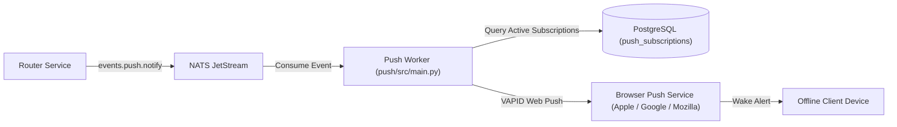

# Push Notification Service (`chatapp-push`)

The `push` service is a background Python daemon responsible for dispatching **Web Push notifications (VAPID)** to offline recipient devices.

It consumes event streams from **NATS JetStream** and communicates with browser push services (Apple Push Notification service, Mozilla Autopush, Google FCM Web Push) via `pywebpush`.

---

## Zero-Knowledge Privacy Guarantee

In accordance with `chatapp`'s zero-knowledge security model:
- **No Plaintext Content**: Push notification payloads contain **strictly zero** message text, preview snippets, or attachment names.
- **No Leaked Metadata**: Payloads contain only a generic wake-up indicator:
  ```json
  {
    "title": "New Encrypted Message",
    "badge": 1,
    "timestamp": 1730418900000
  }
  ```
- **Decryption on Wake**: When the user opens the notification, the web client establishes a secure MQTT connection, downloads the encrypted envelope from `envelopes`, and decrypts the ciphertext locally in the browser with its private Double Ratchet keys.

---

## Architecture & Data Flow



---

## Directory Structure

```
push/
├── Dockerfile              # Lightweight Python 3.12-slim image
├── pyproject.toml          # Dependencies: nats-py, pywebpush, sqlalchemy, asyncpg
└── src/
    ├── __init__.py
    └── main.py             # NATS JetStream subscriber & pywebpush dispatcher
```

---

## Configuration & Environment Variables

| Variable | Description | Example / Default |
|---|---|---|
| `NATS_URL` | NATS JetStream connection endpoint | `nats://nats:4222` |
| `DATABASE_URL` | PostgreSQL connection string | `postgresql+asyncpg://...` |
| `VAPID_PUBLIC_KEY` | Public VAPID key (Base64 URL-safe) | Generated via `webpush` CLI |
| `VAPID_PRIVATE_KEY` | Private VAPID key for signing tokens | Generated via `webpush` CLI |
| `VAPID_CLAIMS_EMAIL` | Contact email in VAPID JWT `sub` claim | `mailto:admin@vajapravin.me` |

### Generating VAPID Keys
To generate new development or production VAPID keys:
```bash
# Using python
python -c "from pywebpush import WebPusher; import json; print(json.dumps(WebPusher.generate_vapid_keypair()))"
```

---

## Resource Usage & Constraints

- **Memory Limit**: `64 MiB` in `docker-compose.yml`.
- **Measured Active RAM**: **~55 MiB**.
