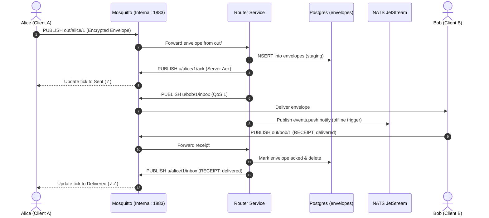

# Router Service (`chatapp-router`)

The `router` service is a high-throughput, low-latency Python asyncio daemon that handles message envelope persistence, fan-out, acknowledgment, and receipt forwarding across the `chatapp` infrastructure.

It bridges **Eclipse Mosquitto** (via `aiomqtt`), **PostgreSQL** (via `sqlalchemy[asyncio]`), and **NATS JetStream** (via `nats-py`).

---

## Architecture & Responsibilities



---

## Key Pipeline Operations

1. **Envelope Capture (`out/#`)**:
   - Subscribes to `out/#` using the system credentials (`router` username and `JWT_SECRET_KEY`).
   - Validates envelope metadata: `id`, `sender_user`, `sender_device`, `recipient_user`, `recipient_device`, `type`, `ciphertext`, `timestamp`.

2. **Persistence & Staging (`envelopes` table)**:
   - Persists all inbound envelopes into PostgreSQL. If a recipient is offline or temporarily disconnected, envelopes remain staged safely in the database.

3. **Immediate Server Acknowledgment**:
   - Publishes `{ "status": "server_ack", "envelope_id": id, "timestamp": now }` to `u/{sender_user}/{sender_device}/ack`.
   - Tells the sender's client that the ciphertext has safely reached server storage (transitioning the message tick from pending clock to single check ✓).

4. **Inbox Fan-Out**:
   - Publishes the envelope with **QoS 1** to `u/{recipient_user}/{recipient_device}/inbox`.

5. **Receipt Processing**:
   - Detects incoming `type: 2` (`RECEIPT`) envelopes from recipient devices (`receipt_status = "delivered"` or `"read"`).
   - Deletes the acknowledged envelope from the database.
   - Forwards the receipt envelope directly to the original sender's inbox `u/{sender_user}/{sender_device}/inbox` to update ticks on the sender's screen.

6. **NATS JetStream Notification Dispatch**:
   - Emits message metadata to subject `events.push.notify` so the `push` worker can dispatch push notifications if the recipient is offline.

---

## Directory Structure

```
router/
├── Dockerfile              # Lightweight Python 3.12-slim container
├── pyproject.toml          # Dependencies: aiomqtt, nats-py, sqlalchemy, asyncpg
└── src/
    ├── __init__.py
    ├── config.py           # Settings loaded from environment
    └── main.py             # Main asyncio loop and MQTT message handler
```

---

## Configuration (`src/config.py`)

Configured via environment variables in `.env`:

| Variable | Description | Default |
|---|---|---|
| `MQTT_HOST` | Mosquitto broker hostname | `mosquitto` |
| `MQTT_PORT` | Mosquitto internal TCP port | `1883` |
| `MQTT_ROUTER_USERNAME` | Internal daemon username | `router` |
| `MQTT_ROUTER_PASSWORD` | System authentication secret | Matches `JWT_SECRET_KEY` |
| `DATABASE_URL` | PostgreSQL connection string | `postgresql+asyncpg://...` |
| `NATS_URL` | NATS JetStream endpoint | `nats://nats:4222` |

---

## Resource Usage & Constraints

- **Memory Limit**: `96 MiB` in `docker-compose.yml`.
- **Measured Active RAM**: **~51 MiB**, well within the NAS resource allocation.
